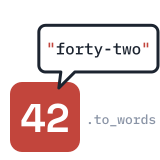

# numbers_and_words

[](https://badge.fury.io/rb/numbers_and_words)
[](https://github.com/kslazarev/numbers_and_words/actions/workflows/test.yml)
[](https://github.com/kslazarev/numbers_and_words/actions/workflows/lint.yml)
[](https://github.com/kslazarev/numbers_and_words/actions/workflows/package.yml)
[](https://coveralls.io/github/kslazarev/numbers_and_words?branch=master)

Spell out numbers in several languages using the I18n gem.

Перевод чисел в слова при помощи библиотеки I18n.

Convertit les nombres en lettres en utilisant la librairie I18n.

Számok betűvel írva az I18n könyvtár segítségével.

I18n kütüphanesi ile sayıları yazıya çevirir.

Soletra números em vários idiomas utilizando a biblioteca I18n.

Deletrea números en varios idiomas utilizando la gema I18n.

## Installation / Установка / Installation

```
gem install numbers_and_words
```

Or add it to your Gemfile:

```ruby
gem 'numbers_and_words'
```

## Usage / Использование / Utilisation

Call `to_words` on an integer, a float or an array within the locale of your choice.

```ruby
require 'numbers_and_words'

I18n.with_locale(:en) { 42.to_words }
# => "forty-two"

I18n.with_locale(:es) { 42.to_words }
# => "cuarenta y dos"

I18n.with_locale(:ru) { 42.to_words }
# => "сорок два"

I18n.with_locale(:fr) { 42.to_words }
# => "quarante-deux"

I18n.with_locale(:de) { 42.to_words }
# => "zweiundvierzig"

I18n.with_locale(:en) { [1, 2, 3].to_words }
# => ["one", "two", "three"]

I18n.with_locale(:en) { 21.77.to_words }
# => "twenty-one point seven seven"
```

Floats that Ruby prints in scientific notation, such as `0.00001` (`1.0e-05`), are expanded to their exact decimal value first.

```ruby
I18n.with_locale(:en) { 0.00001.to_words }
# => "zero point zero zero zero zero one"
```

### Command Line

The gem installs a `to_words` command that spells out each argument, or whitespace-separated numbers read from standard input, one per line.

```
$ to_words 42 1.5
forty-two
one and five tenths

$ to_words --locale ru 2000
две тысячи

$ echo 21 | to_words --ordinal
twenty-first

$ to_words --locale es --gender female 21
veintiuna
```

Choose the language with `-l`/`--locale` (default `en`). Every `to_words` option has a flag: `--ordinal`, `--remove-zero` and other on/off options (with a `--no-` form), and `--gender VALUE`, `--precision N` and `--micro-separator VALUE`. `to_words --help` lists them with the languages that support each. Options a language does not support, invalid numbers, negative numbers and unknown locales are reported on standard error with exit status 1.

## Supported Languages / Языки / Langues Supportées

Each language page has examples, says whether decimals are supported, and documents every option the language accepts, including the shared `precision` and `micro_separator`.

| Language | Name | Code |
| --- | --- | --- |
| [Arabic](docs/languages/ar.md)* | العربية | `ar` |
| [Armenian](docs/languages/hy.md) | Հայերեն | `hy` |
| [Brazilian Portuguese](docs/languages/pt-BR.md) | Português Brasileiro | `pt-BR` |
| [British English](docs/languages/en-GB.md) | English (British) | `en-GB` |
| [Chinese](docs/languages/zh.md)* | 中文 | `zh` |
| [Czech](docs/languages/cs.md) | Čeština | `cs` |
| [Danish](docs/languages/da.md) | Dansk | `da` |
| [Dutch](docs/languages/nl.md) | Nederlands | `nl` |
| [English](docs/languages/en.md) | English | `en` |
| [Estonian](docs/languages/et.md) | Eesti | `et` |
| [French](docs/languages/fr.md) | Français | `fr` |
| [Georgian](docs/languages/ka.md) | ქართული | `ka` |
| [German](docs/languages/de.md) | Deutsch | `de` |
| [Hebrew](docs/languages/he.md)* | עברית | `he` |
| [Hungarian](docs/languages/hu.md) | Magyar | `hu` |
| [Italian](docs/languages/it.md) | Italiano | `it` |
| [Kazakh](docs/languages/kz.md) | Қазақша | `kz` |
| [Latvian](docs/languages/lv.md) | Latviešu | `lv` |
| [Lithuanian](docs/languages/lt.md) | Lietuvių | `lt` |
| [Polish](docs/languages/pl.md)* | Polski | `pl` |
| [Portuguese](docs/languages/pt.md) | Português | `pt` |
| [Russian](docs/languages/ru.md) | Русский | `ru` |
| [Spanish](docs/languages/es.md) | Español | `es` |
| [Swedish](docs/languages/se.md)* | Svenska | `se` |
| [Swiss French](docs/languages/fr-CH.md) | Français (Suisse) | `fr-CH` |
| [Thai](docs/languages/th.md)* | ภาษาไทย | `th` |
| [Turkish](docs/languages/tr.md) | Türkçe | `tr` |
| [Ukrainian](docs/languages/ua.md) | Українська | `ua` |
| [Vietnamese](docs/languages/vi.md) | Tiếng Việt | `vi` |

\* Experimental: the language has known gaps or has not been reviewed by a native speaker yet; its page says why. See [#255](https://github.com/kslazarev/numbers_and_words/issues/255) to help.

Regional locales use their language: `en-AU`, `en-CA`, `en-IN` and `en-US` use `en`; `fr-CA` uses `fr`; `de-AT` and `de-CH` use `de`; `it-CH` uses `it`; `zh-CN` and `zh-SG` use `zh`.

## Options / Опции / Options

Options are passed to `to_words`. Language-specific options such as `gender`, `ordinal` or `remove_zero` are described on each language page linked from Supported Languages.

### Precision

`precision` pads the fractional part of a float with zeros.

```ruby
I18n.with_locale(:ru) { 0.1.to_words(precision: 3) }
# => "ноль целых и сто тысячных"

I18n.with_locale(:es) { 0.2.to_words(precision: 2) }
# => "cero con veinte centésimas"
```

### Micro Separator

`micro_separator` replaces the word between the integral and fractional parts of a float.

```ruby
I18n.with_locale(:en) { 21.77.to_words(micro_separator: "plus") }
# => "twenty-one plus seven seven"
```

### Fallback

`fallback` chooses what happens when the gem cannot convert in the current locale, because the locale has no bundled rules or the configuration disables it. By default this raises `NumbersAndWords::UnsupportedLanguageError`. Set `fallback` to a bundled locale to convert in that locale instead, or to `true` to return the number's digits. There is no implicit fallback locale.

```ruby
I18n.with_locale(:ko) { 42.to_words(fallback: :fr) }
# => "quarante-deux"

I18n.with_locale(:ko) { 42.to_words(fallback: true) }
# => "42"
```

The other options are validated for the fallback locale. `I18n.with_locale` itself raises `I18n::InvalidLocale` for a locale missing from `I18n.available_locales`, before the gem is called. To set a fallback for every call, see [Configuration](#configuration--конфигурация); `fallback: false` disables it for one call.

### Unsupported Options

Every language accepts `precision`, `micro_separator` and `fallback`, plus the options listed on its language page. Any other option, or an unsupported value, raises `NumbersAndWords::UnsupportedOptionError` (an `ArgumentError`) naming the supported alternatives.

For example, Vietnamese has no ordinals, so `21.to_words(ordinal: true)` in the `vi` locale raises:

```
NumbersAndWords::UnsupportedOptionError: unsupported option :ordinal for locale :vi; supported: :micro_separator, :precision, :remove_zero
```

## Configuration / Конфигурация

All bundled locales are loaded by default. To load only some of them, configure the gem after requiring it:

```ruby
NumbersAndWords.configure do |config|
  config.locales = [:en, :ru]
end
```

Or set it directly:

```ruby
NumbersAndWords.config.locales = [:en, :ru]
```

Locale strings and aliases such as `"en-US"` are normalized to their bundled locale. Set `locales` to `nil` to restore all bundled locales, or `[]` to load none. Unsupported locales raise `ArgumentError` without changing the configuration. A direct assignment takes effect immediately; settings in a `configure` block take effect when the block completes, and not at all if it raises.

Set `fallback` to convert in another locale, or to return digits, when the gem cannot convert in the current locale (see [Fallback](#fallback)). The `fallback` option of `to_words` overrides it for one call.

```ruby
NumbersAndWords.config.fallback = :en
```

Configuration replaces only this gem's locale files in `I18n.load_path` and filters its pluralization rules. Application translation files and an explicitly assigned `I18n.available_locales` are preserved. Conversion in a disabled bundled locale raises `NumbersAndWords::UnsupportedLanguageError` (`Language not configured`) unless a fallback is set, even if the application has other translations for it.

Require the gem before your application looks up any translations, as Rails does for gems; files added to `I18n.load_path` after translations are loaded are not picked up until I18n reloads. Configure during application initialization. Applying configuration reloads the configured I18n backend, just like assigning `I18n.load_path`, so store any runtime-only translations afterwards. Repeated configuration is supported and does not duplicate the gem's load paths. The gem does not change `I18n.locale` or `I18n.default_locale`: keep their translations available, or switch your application's current and default locales before removing their previous locale.

## Requirements / Требования / Configuration Requise

* Ruby 3.2 or later, including JRuby.
* I18n, tested with 1.6 and later.

## Upgrading / Обновление / Mise à jour

See [UPGRADING](UPGRADING.md) for breaking changes and how to upgrade.

## Contributing / Участие / Contribuer

See [CONTRIBUTING](CONTRIBUTING.md), [AGENTS](AGENTS.md), [CHANGELOG](CHANGELOG.md), [UPGRADING](UPGRADING.md), [BENCHMARKS](BENCHMARKS.md) and [RELEASING](RELEASING.md).

## License / Лицензия / Licence

MIT License, see [LICENSE](LICENSE.txt).
